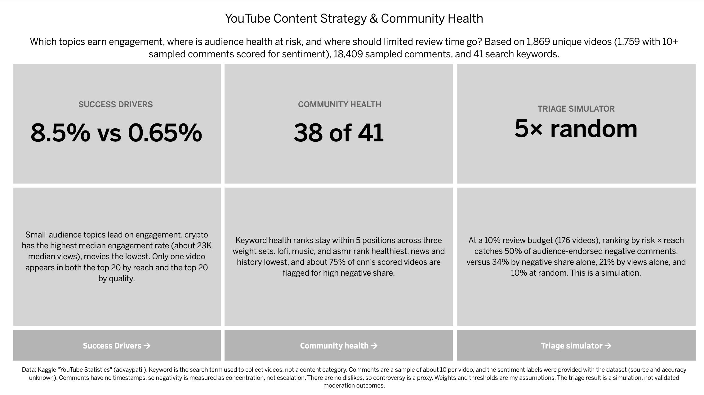

# YouTube Content Strategy & Community Health

An end-to-end SQL and Tableau analysis of 1,869 YouTube videos and 18,409 sampled comments. It answers three questions a content and community team would ask:

1. **Which topics earn the strongest audience engagement?**
2. **Where is audience health at risk?**
3. **If review time is limited, which videos should be reviewed first?**

**Live dashboards:** [Tableau Public link](https://public.tableau.com/views/youtube_analytics_17914280051140/Summary?:language=en-US&:sid=&:redirect=auth&:display_count=n&:origin=viz_share_link)

**Tools:** PostgreSQL, DBeaver, Tableau Public, Excel



---

## Key findings

| Question | Finding |
|---|---|
| Engagement | Small-audience topics lead on engagement rate. The search keyword `crypto` has the highest median engagement rate (about 8.5%, with about 23K median views), while `movies` has the lowest (about 0.65%). The overall median is about 3%. |
| Reach vs. quality | The most-viewed videos are rarely the most engaged-with. Only one video appears in both the top 20 by reach and the top 20 by quality. |
| Community health | `lofi`, `music`, and `asmr` score healthiest. `news`, `history`, `cnn`, and `trolling` score lowest, and about 75% of `cnn`'s scored videos are flagged for high negative share. Across three different weight sets, 38 of 41 keywords stay within 5 rank positions. |
| Review prioritization | In a simulation, reviewing the top 10% of videos (176) ranked by risk × reach catches **50%** of audience-endorsed negative comments, versus 34% when ranking by negative share alone, 21% by views alone, and 10% for random review. That is 5× random and about 2.3× views-only. |

**What this suggests**
- Judge content on reach and engagement quality together. Views alone point to different videos than engagement does.
- Topic-level engagement benchmarks should be read with audience size in mind, because engagement rate tends to fall as reach grows.
- A review queue that combines negative share, split sentiment, and reach finds endorsed negativity faster than ranking by views or by negative share alone.

---

## Dashboards

| Dashboard | What it shows |
|---|---|
| Success Drivers | Median engagement by keyword, a reach-vs-engagement scatter of all videos, and top-20 tables by reach or by quality |
| Community Health | A 0–100 health score by keyword with adjustable weight sliders, a positive-vs-negative sentiment scatter, and a top-25 review queue |
| Triage Simulator | Capture curves comparing five review strategies, with an adjustable review budget |
| Summary | Three headline findings and the data limitations |

---

## Data

**Source:** Kaggle, [YouTube Statistics](https://www.kaggle.com/datasets/advaypatil/youtube-statistics) (advaypatil). Check the dataset's license before redistributing it. The raw files are not included in this repository.

| File | Contents |
|---|---|
| `videos-stats.csv` | Title, Video ID, Published At, Keyword, Likes, Comments, Views (1,881 rows, 1,869 unique video IDs, 41 keywords) |
| `comments.csv` | Video ID, Comment, Likes, Sentiment (18,409 comments; sentiment 0 = negative, 1 = neutral, 2 = positive) |

Sentiment split: 62.1% positive, 25.2% neutral, 12.7% negative.

---

## Method

### 1. Cleaning and preparation
- **Hidden likes and disabled comments** are stored as `-1`. These become NULL, and "comments disabled" is kept as its own flag. 7 videos have hidden likes and 2 have comments disabled.
- **Blank rows:** 2 rows with no views, likes, or comments are dropped.
- **Duplicate video IDs:** 12 video IDs appear under two keywords. The highest-views row is kept. For 8 of the 12 the views are identical, so ties are broken alphabetically by keyword. Without an explicit tie-break, results changed between runs.
- **Titles:** HTML entities (such as `&#39;`) are decoded.
- **Scoring population:** 1,858 videos have the data needed for engagement metrics. 1,759 of them have 10 or more sampled comments and are scored for sentiment.

### 2. Engagement metrics
| Metric | Definition |
|---|---|
| Engagement rate | (likes + comments) / views |
| Like-to-view ratio | likes / views |
| Comment rate | comments / views |
| Reach score | views + likes + comments (effectively a views ranking) |
| Quality score | Average percent rank of views, like-to-view ratio, and comment rate |

Views are extremely skewed (median about 592K, mean about 11.6M, maximum about 4 billion), so the analysis uses medians and percentile ranks, not averages.

### 3. Community health
| Metric | Definition |
|---|---|
| Net sentiment | % positive comments minus % negative comments |
| Controversy (proxy) | 2 × min(% positive, % negative). It peaks when comments split evenly, since the dataset has no dislikes |
| Negative flag | Video's negative share is in the top 10% (40% or more negative; 198 of 1,759 videos) |
| Endorsed negatives | Negative comments with likes at or above the 90th percentile (318 comments across 232 videos) |
| Risk score | Average percent rank of negative share and controversy |
| Priority | Risk score × ln(1 + views) |
| Health score (keyword) | 0–100, weighted from percent ranks of net sentiment, flag rate (inverted), and average controversy. Default weights 40 / 30 / 30 |

The health-score weights are adjustable in Tableau. Two other weight sets (60 / 20 / 20 and 20 / 40 / 40) are used as a sensitivity check.

### 4. Triage simulation
Videos are ranked by each strategy, then "reviewed" from the top. The outcome measure is the share of all endorsed negative comments sitting in the reviewed videos. Endorsed negatives are held out of the risk score, so the simulation is not circular. Five strategies are compared: risk × reach, negative share then views, views only, an "ideal" hindsight ranking (an upper bound), and random review (the expected value).

---

## Limitations

- **Keyword is a search term, not a content category.** Videos were collected by keyword, with about 50 per keyword, and some match song titles (for example, "Rotimi - In My Bed" and "Powfu - death bed" under `bed`). Keyword-level findings describe the search results, not whole topics.
- **Comments are a sample of about 10 per video,** and how they were chosen is unknown. Sentiment shares move in 10% steps.
- **Sentiment labels** came with the dataset. Their source and accuracy are unknown.
- **No comment timestamps,** so negativity is measured as concentration, not escalation over time.
- **No dislikes,** so controversy is a proxy.
- **Views are a single snapshot,** so older videos have had longer to accumulate. Most videos are from 2022.
- **Weights and thresholds are assumptions.** The triage result is a simulation under stated assumptions, not validated moderation outcomes. Endorsed negatives are sparse.
- **No significance testing or modeling.** Findings are descriptive associations.

---

## Repository structure

```
youtube-content-strategy/
├── README.md
├── sql/
│   ├── 01_phase1_views.sql              # cleaning, sentiment table, endorsed negatives
│   ├── 02_phase2_success_drivers.sql    # engagement metrics, quality score, keyword leaderboard
│   └── 03_phase3_community_health.sql   # risk, health score, triage simulation
├── docs/
│   └── assumptions_log.xlsx             # feasibility checks, findings, decisions
└── images/                              # dashboard screenshots
```

---

## How to reproduce

1. **Get the data.** Download the two CSVs from Kaggle.
2. **Create the tables** in PostgreSQL (both CSVs have an unnamed first column, and their numbers are stored like `3407.0`, hence `numeric`):

```sql
CREATE TABLE videos (idx int, title text, video_id text, published_at date,
  keyword text, likes numeric, comments numeric, views numeric);
CREATE TABLE comments (idx int, video_id text, comment text, likes numeric, sentiment numeric);
```

3. **Import the CSVs.** In DBeaver, use header on, UTF-8, "set empty strings to NULL", and map each column by hand. Expected counts: 1,881 rows in `videos` and 18,409 in `comments`.
4. **Run the scripts in order** (in DBeaver, Alt+X executes a whole script): `01`, then `02`, then `03`. Each ends with check queries and the values to expect.
5. **Build the dashboards.** Export these views to CSV and connect them in Tableau: `v_video_summary`, `v_rank_compare`, `v_keyword_leaderboard`, `v_risk`, `v_keyword_health_scores`, and `v_capture`. Do not export the `comments` table, so no comment text is published.

---

## Skills demonstrated

- SQL: CTEs, window functions (`PERCENT_RANK`, `NTILE`, `RANK`, running totals), `PERCENTILE_CONT`, conditional aggregation, views
- Data quality: handling sentinel values, duplicates, ties, and reproducibility
- Metric design: engagement, quality, sentiment, risk, and health scores with documented assumptions
- Validation: independent recalculation of results and sensitivity checks
- Tableau: parameters, calculated fields, dual-axis and multi-source dashboards, interactive controls
- Communication: stating limitations and avoiding overclaiming

---

## Next steps

With comment timestamps, channel data, dislikes, and full comment counts, the analysis could add escalation detection, creator-level benchmarks, true controversy measures, and a validated risk model.
